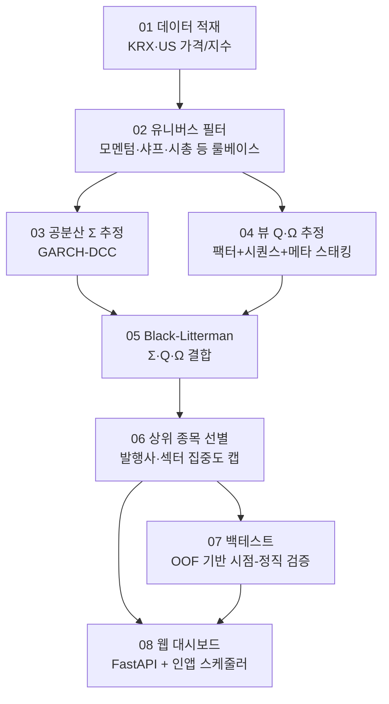
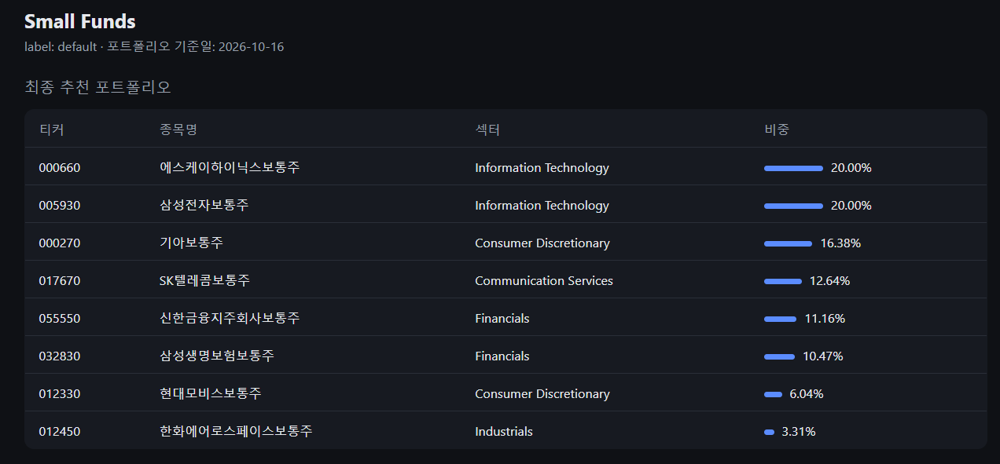
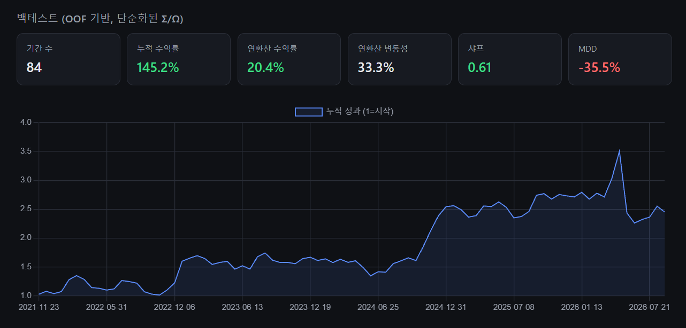

# Small Funds

Black-Litterman 기반 포트폴리오 파이프라인. 데이터 적재 → 유니버스 필터 → DCC-GARCH 기반 공분산(Σ) 추정 → ML 기반 뷰(Q, Ω) 추정 → Black-Litterman → 상위 종목 선별 → 백테스트 → 웹 대시보드까지 이어지는 모듈형 파이프라인 (01~08). 각 단계의 설계 이유는 모듈별 `DESIGN.md`를, 전체 요약은 [`SKILLS.md`](SKILLS.md)를 참고.



## 사전 준비물
- Python 3.11+
- [Docker Desktop](https://www.docker.com/products/docker-desktop/) (로컬 Postgres용)
- KRX Open API 키 — [data-dbg.krx.co.kr](https://data-dbg.krx.co.kr)에서 무료 발급 (카테고리 승인에 보통 1일 소요)
- Anthropic API 키 — [console.anthropic.com](https://console.anthropic.com/settings/keys) (06_post_filter의 섹터 분류용)

## 설치
```bash
git clone https://github.com/GongsonChan/Portfolio-project.git
cd Portfolio-project
python -m venv .venv
.venv\Scripts\activate       # Windows. macOS/Linux: source .venv/bin/activate
pip install -r requirements.txt
```

## 한 번에 세팅 (추천)
```bash
python setup.py          # .env 생성(API 키 입력 프롬프트) + DB 기동 + 최근 1년치로 전체 파이프라인 1회 실행
python setup.py --full   # 전체 히스토리로 (느림, 수 시간~하루 이상 -- 아래 "데이터 채우기" 참고)
```
`.env`가 없으면 KRX_API/ANTHROPIC_API_KEY를 그 자리에서 물어보고 만들어줌 (어디서 발급받는지도 같이 안내). 이미 `.env`가 있으면 그대로 두고 건너뜀. DB 컨테이너가 준비될 때까지 기다린 다음 01→07을 순서대로 실행하고 끝에 다음 할 일을 알려줌.

### 직접 단계별로 하고 싶을 때
`docker compose up`만 먼저 해두면(아래), 각 단계를 원하는 범위/순서로 직접 돌릴 수 있음 — `setup.py`가 내부적으로 하는 걸 그대로 풀어둔 것.
```bash
cp 01_data_load/.env.example 01_data_load/.env
# .env 열어서 KRX_API, ANTHROPIC_API_KEY 채우기 (POSTGRES_*는 아무 값이나 괜찮음)

cd 01_data_load
docker compose up -d          # Postgres 컨테이너 기동 + 전체 스키마(01~07) 자동 생성
cd ..
```
`docker compose up`이 전체 파이프라인의 모든 테이블을 한 번에 만듦 — `docker-compose.yml`이 각 모듈의 `db/*.sql`을 순서대로(FK 의존성상 `securities`가 제일 먼저) 마운트해서 Postgres 최초 기동 시 전부 실행함. 각 모듈 폴더의 `db/*.sql`이 원본이고, 따로 복사해둔 파일은 없음(수정하면 바로 반영됨).

## 데이터 채우기 (수동으로 할 경우)

**주의**: 전체 히스토리(10년치 가격 + GARCH 전체 재추정 + OOF 전체 재구축)를 처음부터 다 돌리면 **수 시간~하루 이상** 걸림(특히 시퀀스 모델 OOF 재구축이 날짜당 수초씩 걸려 수십~수백 분). `setup.py`도 내부적으로 아래와 같은 순서임 — 아래는 직접 손으로 할 때 참고용.

### A. 빠르게 파이프라인만 확인하고 싶을 때 (짧은 기간)
```bash
cd 01_data_load
python scripts/backfill_krx.py --start 2024-01-01
python scripts/backfill_us.py --start 2024-01-01
python scripts/backfill_index.py --start 2024-01-01

cd ../03_sigma_estimation
python scripts/fit_univariate_garch.py   # 전체 종목 GARCH 모수 추정 (유니버스와 무관, 먼저 돌려도 됨)

cd ../02_filter
python scripts/run_filter.py             # 유니버스 선정 -- DCC가 이 결과를 가져다 씀

cd ../03_sigma_estimation
python scripts/fit_dcc.py                # 방금 선정된 유니버스로 DCC 추정

cd ../04_views_estimation
python scripts/backfill_features.py --start 2024-01-01   # ml_features 테이블 채우기 (OOF가 이걸 읽음)
python scripts/run_oof.py --start 2024-01-01
python scripts/run_sequence_oof.py --start 2024-01-01
python scripts/run_meta_oof.py
python scripts/train_final_models.py
python scripts/compute_omega.py
python scripts/run_inference.py

cd ../05_black_litterman && python scripts/run_black_litterman.py
cd ../06_post_filter && python scripts/run_post_filter.py
cd ../07_backtest && python scripts/run_backtest.py
```
기간이 짧으면 시퀀스 모델(GRU/CNN/PatchTST)이 충분한 학습 데이터를 못 가질 수 있음 — 파이프라인이 안 깨지는지 확인하는 용도로 보면 됨.

### B. 실제로 쓸 거라면 (전체 히스토리)
위와 동일하되 `--start` 생략 (기본값: 전체 히스토리). 순서는 반드시 지킬 것 — 뒷 단계가 앞 단계 결과를 그대로 가져다 씀: `01_data_load/scripts/backfill_*.py` → `03_sigma_estimation/fit_univariate_garch.py`(전체 재추정 ~29분) → `02_filter/run_filter.py` → `03_sigma_estimation/fit_dcc.py` → `04_views_estimation`(`backfill_features.py`로 피처 먼저 채우고 OOF, 시퀀스 OOF가 제일 오래 걸림) → `05`/`06`/`07`.

## 매일/매주 갱신
최초 세팅 끝나면 그 다음부터는 수동으로:
```bash
python scripts/daily_update.py    # 평일: 가격 + Σ/Q 가벼운 갱신 + BL + post-filter
python scripts/weekly_update.py   # 주말: 유니버스 재선정 + 모수 전체 재추정 + 모델 재학습
```
자세한 스케줄/이유는 `DAILY_UPDATE.md` 참고. (아래 웹 대시보드를 띄워두면 이 둘을 수동으로 돌릴 필요 없음 — 자동 스케줄링 참고)

## 웹 대시보드
```bash
cd 08_web
python app.py
```
`http://127.0.0.1:8000` — 오늘의 추천 포트폴리오 + 백테스트 성과(샤프/MDD/누적수익률).




### 자동 스케줄링 (앱 내장)
OS 스케줄러(cron/작업 스케줄러) 설정 없이, **앱 프로세스 자체가** 스케줄을 가지고 있음 (`08_web/src/scheduler.py`, APScheduler) — `python app.py`를 켜두는 동안은 평일 08:00에 `daily_update.py`, 토요일 09:00에 `weekly_update.py`가 자동으로 실행됨. 긴 작업이라 별도 워커 스레드에서 돌아서 대시보드 자체는 그동안도 계속 응답함. 서버 프로세스가 꺼지면(재부팅, 터미널 종료 등) 스케줄도 같이 멈추므로, 계속 자동으로 돌아가게 하려면 이 프로세스를 계속 띄워두거나(서버에 배포 등) 별도 프로세스 매니저로 관리해야 함. 시간은 `scheduler.py` 상단의 `DAILY_HOUR`/`WEEKLY_HOUR` 등 상수로 조절 가능.

## 구조
| 모듈 | 역할 |
|---|---|
| `01_data_load` | KRX/US 가격, 지수 데이터 적재 |
| `02_filter` | 룰베이스 유니버스 필터 (모멘텀/샤프/시총 등) |
| `03_sigma_estimation` | GARCH-DCC로 공분산행렬(Σ) 추정 |
| `04_views_estimation` | ML 기반 뷰(Q)와 불확실성(Ω) 추정 (스태킹: 팩터+시퀀스+메타) |
| `05_black_litterman` | Σ/Q/Ω를 Black-Litterman으로 결합, 유니버스 전체 비중 산출 |
| `06_post_filter` | 상위 N개 선별 + 발행사/섹터 집중도 캡 (LLM 섹터 분류 포함) |
| `07_backtest` | OOF 기반 과거 성과 검증 (look-ahead 없이 시점-정직) |
| `08_web` | 로컬 대시보드 (FastAPI) |

각 모듈 폴더의 `DESIGN.md`에 "왜 이렇게 설계했는지"가 정리돼 있음.
